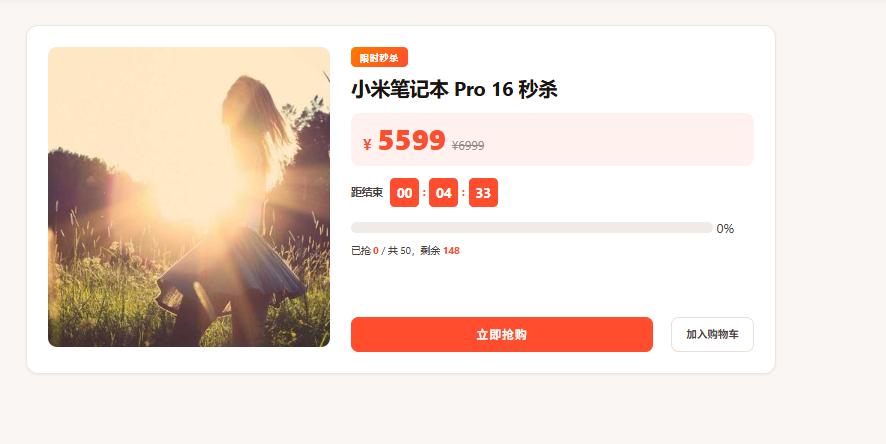
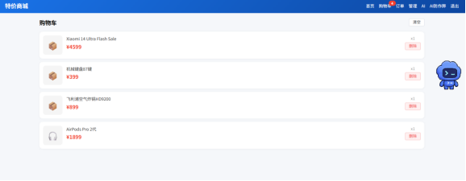
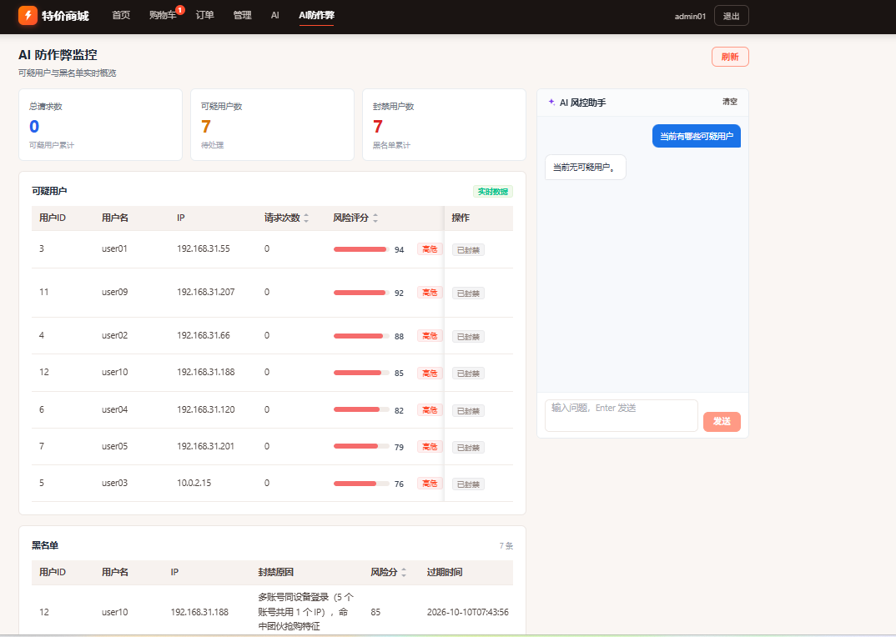
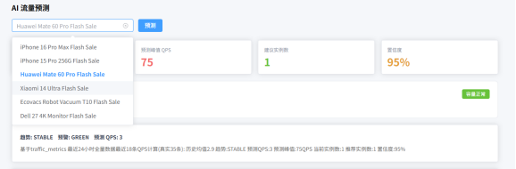

# 智能电商微服务秒杀系统（flash-sale-system）

> 基于 **Spring Cloud Alibaba + Vue 3 + AI 风控** 的分布式秒杀系统，解决高并发场景下的库存超卖、恶意刷单与流量洪峰问题。

## 1. 项目简介

本系统是一个面向高并发秒杀场景的智能电商微服务项目，采用「**网关限流 → AI 风控 → Redis 原子扣库存 → 订单落库**」的完整秒杀链路，在并发洪峰下保证「**不超卖、不超购、防脚本刷单**」，并引入 DeepSeek 大模型对可疑行为做二次研判，实现从「被动限流」到「主动反作弊」的能力升级。

## 2. 技术栈

### 后端
| 类别 | 技术 |
|---|---|
| 基础框架 | Spring Boot 2.7.18 · Spring Cloud 2021.0.8 · Spring Cloud Alibaba 2021.0.1.0 |
| 服务治理 | Nacos（注册中心 + 配置中心） |
| 服务网关 | Spring Cloud Gateway（Reactive） |
| 服务调用 | OpenFeign + Sentinel 熔断降级 |
| 限流熔断 | Sentinel（QPS 限流 + 异常比熔断） |
| ORM | MyBatis-Plus 3.5.7 |
| 缓存 / 分布式 | Redis 7 + Redisson 3.27.2（分布式锁 / Lua / 原子操作） |
| 认证 | JWT（jjwt 0.12.5）+ BCrypt |
| 工具 | Hutool 5.8.28 · Fastjson2 · Lombok |
| AI 能力 | DeepSeek API（OpenAI 兼容，可配置可降级） |

### 前端
| 类别 | 技术 |
|---|---|
| 框架 | Vue 3（Composition API） |
| 构建 | Vite 5 |
| 状态管理 | Pinia 2 |
| 路由 | Vue Router 4 |
| UI | Element Plus 2.7 |
| 可视化 | ECharts 5 |
| HTTP | Axios |

### 中间件
| 中间件 | 用途 | 端口 |
|---|---|---|
| MySQL 8.0 | 业务数据持久化 | 3307（容器映射） |
| Redis 7 | 库存预减 / 幂等 / 防刷计数 / 分布式锁 | 6379 |
| Nacos 2.2.3 | 服务注册发现、配置中心 | 8848 |
| Sentinel Dashboard 1.8.6 | 限流熔断监控 | 8858 |

## 3. 秒杀核心亮点与难点突破

### 3.1 超卖问题：Redis Lua 原子预减库存 + 双兜底

秒杀下单前不直接扣 MySQL，而是先对 Redis 库存做**原子预减**。核心在 `inventory-service` 的 `InventoryService.decreaseStock`：

```java
// Lua 脚本保证「判断 + 扣减」在 Redis 内原子执行，无并发窗口
String LUA_DECR =
    "local s = redis.call('get', KEYS[1]) " +
    "if not s then return -1 end " +
    "if tonumber(s) < 1 then return 0 end " +
    "redis.call('decr', KEYS[1]) return 1";

Long result = redissonClient.getScript()
    .eval(RScript.Mode.READ_WRITE, LUA_DECR,
          RScript.ReturnType.INTEGER,
          Collections.singletonList(STOCK_KEY + activityId));
if (result == null || result <= 0) return false;  // 库存不足
```

**三道防线**：
1. **Lua 原子扣减**（主力）——库存判断与扣减合并为一条 Lua 命令，天然无并发竞争；
2. **Redisson 分布式锁 + MySQL 乐观锁**（兜底）——`decreaseStockWithLock` 走 `RLock` + `lockStock(productId, quantity, version)` 乐观锁，作为降级路径；
3. **失败回滚**——订单创建异常时调用 `releaseStock`（`LUA_INCR`）把库存加回去，避免「扣了库存没下单」。

> 细节：`releaseStock` 显式用 `StringCodec` 传参，规避 Redisson 默认二进制编解码导致 Lua `tonumber` 解析失败的问题（代码内已注释说明）。

### 3.2 限流与防刷：Sentinel + AI 规则引擎 + 黑名单

**① Sentinel 限流（网关 + 服务双层）**
- 网关层：`SentinelGatewayConfig` 配置 SCG 流控，超限返回 `429` + JSON 兜底（`{"code":1002,"message":"系统繁忙"}`）。
- 服务层：秒杀接口打 `@SentinelResource(value="flash:seckill", blockHandler="seckillBlock")`，QPS 阈值由 `flash.sale.qps.limit` 动态配置（默认 500），超限走 `seckillBlock` 快速失败。

**② AI 防刷规则引擎（本项目最大亮点）**
`CheatingRuleEngine` 基于「实时特征 + 加权打分」识别脚本/机器刷单，四维特征全部由 `FeatureCollector` 用 Redis 原子操作实时采集：

| 维度 | 特征 | Redis 实现 | 权重 |
|---|---|---|---|
| 高频 | 近 1 秒请求频率 | `cheat:freq:{uid}`（1s TTL 自增） | 0.5 |
| 多账号 | 同 IP 账号数 | `cheat:ip:{ip}` Set | 0.4 |
| 规律性 | 请求时间间隔标准差 | `cheat:tl:{uid}` List（保留 10 条） | 0.4 |
| 集中度 | 3 秒内同活动并发 | `cheat:act:{aid}:{秒}` 计数 | 0.25 |

评分达到「可疑(review)」阈值进入监控名单；达到「封禁(block)」阈值直接拦截并写入黑名单。**DeepSeek 大模型仅在 review 阶段做二次研判**（生成自然语言风险说明），秒杀主链路走纯本地计算，**不引入任何网络耗时**，且 `enabled=false` / 无 key 时自动降级，不影响主流程。

**③ 黑名单网关拦截**
被拉黑的 `userId` / `IP` 写入 Redis（`cheat:block:u:{uid}` / `cheat:block:ip:{ip}`），由网关 `BlacklistGlobalFilter` 统一拦截，未到业务层即被 403 拒绝，公开只读接口不误伤。

### 3.3 异步削峰：Feign 同步下单 + 异步库存落库

> 说明：本项目采用 **同步扣减 + 异步持久化** 的轻量削峰方案，未引入 MQ。秒杀库存预减由 Redis 承担瞬时压力，MySQL 的 `sold_count` 同步通过 `@Async` 线程池异步执行，不阻塞下单主链路。

```
秒杀请求
  → 网关限流(Sentinel)
  → 黑名单校验(Redis)
  → 幂等校验(Redis trySet)
  → AI 防刷评分(本地规则引擎)
  → 防重购(Redis USER_BUY_KEY)
  → Redis Lua 原子扣库存  ←—— 唯一高并发写热点，交给 Redis
  → Feign 同步创建订单    ←—— 串行落库，保证一致性
  → @Async 异步同步 sold_count  ←—— 异步，不阻塞
```

`StockSyncService` 通过 `@Async("stockSyncExecutor")` 异步把扣减量同步到 MySQL，`AsyncConfig` 配置专用线程池；下单失败时同步 `releaseStock` 回滚，保证最终一致。

### 3.4 幂等与防重复下单

- **幂等 Token**：前端每次抢购生成 `idempotencyToken`（`crypto.randomUUID()`），服务端用 `redisson.getBucket(idemKey).trySet("1", 5min)` 保证同一 Token 只生效一次，杜绝网络重试导致的重复下单。
- **防重购**：`flash:user:buy:{activityId}:{userId}` 以活动结束时间为 TTL，限制同一用户对同一活动只能抢一次。
- **分布式锁**：订单落库前用 `Redisson RLock`（`order:lock:{uid}:{aid}`）串行化同一用户同活动的下单，`RedissonLockUtil` 封装了 `tryLock` 超时语义。

### 3.5 分布式 ID 生成：雪花算法

订单号通过 Hutool 的雪花算法生成：`IdUtil.getSnowflakeNextIdStr()`，全局唯一且趋势递增，无需额外部署 ID 生成服务。秒杀令牌用 `IdUtil.simpleUUID()`。

## 4. 项目结构

```
电商微服务系统_项目代码
├── docker-compose.yml          # 中间件编排（MySQL/Redis/Nacos/Sentinel）
├── init.sql                    # Docker 首启建库脚本（3 张基础表）
├── schema_v2.sql               # 完整建表脚本（8 张表）
└── flash-sale-system
    ├── pom.xml                 # 父工程（依赖管理 / 模块聚合）
    ├── common/                 # 公共模块：Result / 异常 / JWT / Redis 工具
    ├── gateway-service/        # 网关：路由、限流、鉴权、黑名单（8080）
    ├── auth-service/           # 认证：登录注册、JWT、BCrypt（8101）
    ├── product-service/        # 商品：CRUD、列表（8102）
    ├── inventory-service/      # 库存：Redis Lua 扣减、乐观锁兜底（8103）
    ├── flash-sale-service/     # 秒杀：核心下单链路 + AI 风控（8104）
    ├── order-service/          # 订单：下单、支付、取消、超时关单（8105）
    ├── ai-service/             # AI：流量预测、作弊报告（8106，独立）
    └── flash-sale-frontend/    # 前端：Vue3 + Vite + Element Plus（3000）
        └── src
            ├── api/            # axios 封装与接口定义
            ├── store/          # Pinia（auth / cart）
            ├── router/         # 路由
            ├── composables/    # 倒计时 / 防抖
            ├── utils/          # 错误码映射
            └── views/          # Home / FlashSaleDetail / Login / Orders / Admin / AiCheatDetect ...
```

### 微服务分层（以 flash-sale-service 为例）

```
com.flashsale.flashsale
├── controller/    # FlashSaleController / AiController / CheatMonitorController / SeckillTokenController
├── service/       # FlashSaleService（下单链路）/ CheatMonitorService / AiAssistantService
├── ai/            # CheatingRuleEngine / FeatureCollector / QpsCollector / DeepSeekService / BlacklistService
├── feign/         # GoodsClient / InventoryClient / OrderClient（含 FallbackFactory）
├── mapper/        # SeckillActivityMapper / UserMapper / ...
├── entity/        # SeckillActivity / User / CheatBlacklist / TrafficMetrics
├── dto/           # OrderDTO
├── filter/        # QpsFilter（QPS 采集）
└── config/        # SentinelRuleConfig / DynamicConfig / WebConfig
```

## 5. 快速开始

### 环境要求
- JDK 21 · Maven 3.9+ · Node.js 22+ · Docker Desktop

### 5.1 启动中间件

在项目根目录执行：

```bash
docker-compose up -d
```

启动后核对（MySQL 映射到宿主机 **3307**，root / root）：

| 中间件 | 地址 | 账号/密码 |
|---|---|---|
| MySQL | 127.0.0.1:3307 | root / root |
| Redis | 127.0.0.1:6379 | 无密码 |
| Nacos | http://localhost:8848/nacos | nacos / nacos |
| Sentinel | http://localhost:8858 | sentinel / sentinel |

### 5.2 初始化数据库

Docker 首启会自动执行 `init.sql`（建库 `flash_sale_db` + 3 张基础表）。如需完整 8 张表，手动导入 `schema_v2.sql`：

```bash
mysql -h127.0.0.1 -P3307 -uroot -proot flash_sale_db < schema_v2.sql
```

### 5.3 启动后端（6 个服务）

按依赖顺序启动，各服务 `application.yml` 已配置本地 `localhost` 连接：

| 服务 | 端口 | 启动顺序 |
|---|---|---|
| auth-service | 8101 | 1 |
| product-service | 8102 | 2 |
| inventory-service | 8103 | 3 |
| flash-sale-service | 8104 | 4 |
| order-service | 8105 | 5 |
| gateway-service | 8080 | 6 |

> **注意**：若在命令行 `java -jar` 启动，请显式指定端口 `--server.port=8101`，否则可能因环境变量覆盖导致端口冲突。

### 5.4 启动前端

```bash
cd flash-sale-system/flash-sale-frontend
npm install
npm run dev
```

访问 http://localhost:3000（Vite 已代理 `/api` → `http://localhost:8080`）。

### 5.5 测试账号

| 角色 | 账号 | 密码 |
|---|---|---|
| 管理员 | admin01 | 123456 |
| 普通用户 | demo01 | 123456 |

## 6. 效果预览

### 核心业务

<table align="center">
  <tr>
    <td align="center" width="30%">
      
      <br /><b>首页</b>：秒杀会场与商品展示
    </td>
    <td align="center" width="30%">
      
      <br /><b>商品详情</b>：秒杀商品详情与抢购
    </td>
    <td align="center" width="30%">
      
      <br /><b>购物车</b>：购物车管理
    </td>
  </tr>
</table>

### AI 亮点

<table align="center">
  <tr>
    <td align="center" width="35%">
      
      <br /><b>AI 风险预测</b>：作弊用户风险研判
    </td>
    <td align="center" width="35%">
      
      <br /><b>AI 流量预测</b>：秒杀流量峰值预测
    </td>
  </tr>
</table>

## 7. 压测结果

> 以下为占位符，替换为实际压测数据。

| 指标 | 数值 |
|---|---|
| 并发线程数 | `__CONCURRENT__` |
| QPS | `__QPS__` |
| TPS | `__TPS__` |
| 平均响应时间 | `__AVG_RT__` ms |
| 99 分位延迟 | `__P99__` ms |
| 错误率 | `__ERROR_RATE__` % |
| 是否出现超卖 | 否（库存为 0 即停） |

---

## 附：核心接口一览

| 接口 | 方法 | 说明 |
|---|---|---|
| `/api/auth/login` | POST | 登录（返回 JWT） |
| `/api/auth/register` | POST | 注册 |
| `/api/product/list` | GET | 商品分页列表 |
| `/api/flash-sale/list` | GET | 进行中的秒杀活动 |
| `/api/flash-sale/detail/{id}` | GET | 活动详情 |
| `/api/flash-sale/seckill/{id}` | POST | 秒杀下单（需幂等 Token） |
| `/api/inventory/stock/{id}` | GET | 查询 Redis 库存 |
| `/api/order/list` | GET | 我的订单 |
| `/api/order/pay/{no}` | POST | 支付 |
| `/api/ai/predict-traffic` | POST | AI 流量预测 |
| `/api/ai/cheat-users` | GET | 作弊用户监控列表 |
